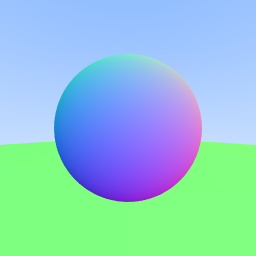
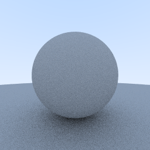
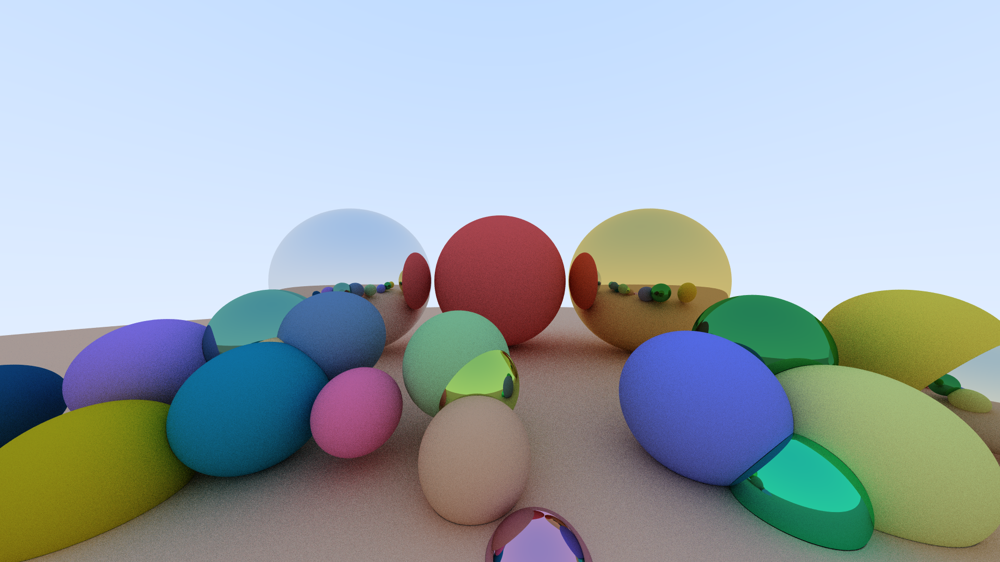

  
# <ins>Raytracer</ins>

## ⭐ About the Project
This project started as a specialization project at school, where I had to choose a specialization for my final year at [ISART Digital](https://www.isart.fr/). I'm still working on it in my free time to improve my GPU programming skills.

The project is written in  and built using . For GPU programming, I use  to ensure compatibility across different GPUs.

## 📦 Repository Statistics

 

 

## ☕ Getting Started
> TODO

## 📸 Screenshots

## 📄 License
- [GPL-3.0 License](LICENSE)
